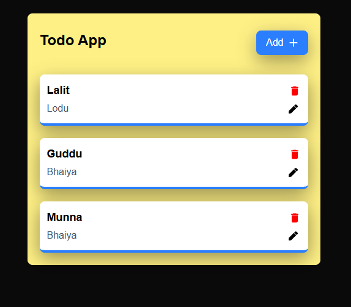
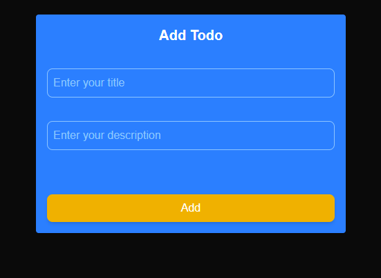
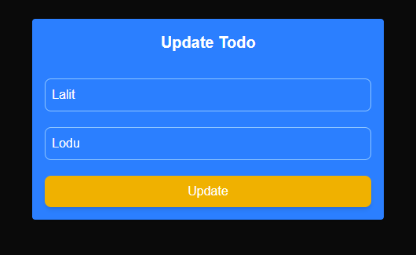
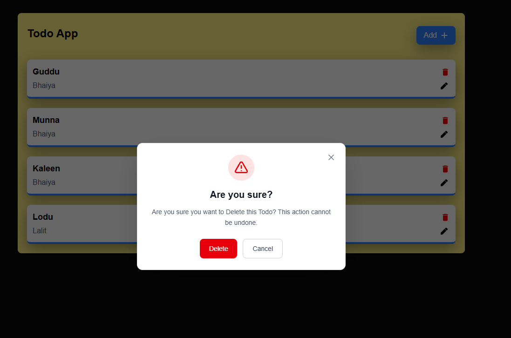

📝 Todo App — Next.js

A simple and responsive Todo App built with Next.js that allows users to manage their daily tasks with CRUD (Create, Read, Update, Delete) operations.

## 📸 Screenshots

### 🏠 Home Page

Displays the list of todos with options to edit and delete tasks.

### ➕ Add Todo

Add a new task by entering its title and description.

### ✏️ Update Todo

Update the title and description of an existing task.

### 🗑️ Delete Todo

Delete unwanted tasks from the todo list.

✨ Features

➕ Create Todo — Add new tasks with a title and description.

📋 Read Todos — View all saved tasks on the home page.

✏️ Update Todo — Edit existing task details.

🗑️ Delete Todo — Remove tasks when they are no longer needed.

🔗 Dynamic Routing — Navigate to individual todo update pages using dynamic routes.

⚡ API Integration — Perform CRUD operations through API endpoints.

🔔 Toast Notifications — Get feedback for successful and failed operations.

🎨 Clean UI — Simple interface styled with Tailwind CSS.

## 🛠️ Tech Stack

-Next.js — React framework

-React.js — UI development

-Tailwind CSS — Styling

-Axios — HTTP requests

-React Icons — Icons

-React Hot Toast — Notifications

-REST API — CRUD operations

## 🔄 CRUD Operations

-Operation

-Description

-Create

-Add a new todo

-Read

-Fetch and display todos

-Update

-Edit an existing todo

-Delete

-Remove a todo

## 🎯 Purpose

This project was built to practice Next.js, React state management, dynamic routing, API integration, and CRUD functionality while creating a clean and user-friendly interface.

## 🚀 Future Improvements

Add task completion status.

Add search and filtering.

Improve form validation.

Add user authentication.

Enhance mobile responsiveness.

## 👨‍💻 Author

**Vishal Katarha**

- GitHub: https://github.com/VishalKatarha
- LinkedIn: https://linkedin.com/in/vishalkatarha

⭐ If you like this project, consider giving it a star!